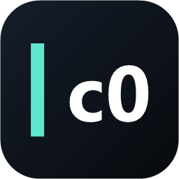

<div align="center">
  
  <h1>c0n50le</h1>
  <p><strong>La tua libreria PC, pronta da giocare dal divano.</strong></p>
  <p>Una home a schermo intero per avviare giochi e app con il controller, su Windows 10 e 11.</p>
  <p>
    <a href="https://github.com/1r0n51uv/c0n50le/releases/latest"></a>
  </p>
  <p>
    <a href="https://github.com/1r0n51uv/c0n50le/releases/latest"></a>
    <a href="https://github.com/1r0n51uv/c0n50le/actions/workflows/ci.yml"></a>
    
    
    <a href="LICENSE"></a>
  </p>
  <p><a href="#funzionalità">Funzionalità</a> · <a href="#download">Download</a> · <a href="#sviluppo">Sviluppo</a></p>
</div>

c0n50le porta la tua libreria PC in una home ispirata a tvOS. Scegli un gioco nel dock per vedere artwork, logo e descrizione a tutto schermo. Avvialo dalla card e torna alla home quando vuoi cambiare gioco. Puoi usare anche mouse e tastiera.

## Funzionalità

- **Una libreria, più sorgenti.** Rileva i giochi di Steam ed Epic, legge una cartella organizzata con una sottocartella per gioco e permette di aggiungere eseguibili a mano. Gli ultimi giocati compaiono per primi.
- **Copertine, sfondi e loghi.** L'abbinamento con LaunchBox Games Database è automatico quando il titolo è riconosciuto con certezza. Puoi anche cercare un altro titolo e vedere l'anteprima prima di confermare.
- **Avvia, torna alla home, riprendi.** Premi <kbd>Ctrl</kbd> + <kbd>Alt</kbd> + <kbd>F11</kbd> oppure <kbd>Visualizza</kbd> + <kbd>Y</kbd> sul controller per tornare alla home durante una partita. Seleziona di nuovo la card per riprendere il gioco aperto. Alla chiusura del gioco, la home riappare da sola.
- **Dal controller al mouse, al volo.** Con i controller Xbox, PlayStation e Switch Pro l'interfaccia evidenzia l'elemento selezionato, mostra i suggerimenti dei pulsanti e nasconde il puntatore. Muovi il mouse o premi un tasto per cambiare modalità.
- **La home come la vuoi tu.** Tema chiaro o scuro, barra in alto e dock in Liquid Glass regolabile su tre profondità o disattivabile, menu contestuali, suoni, musica e tour guidato.
- **Widget nella home.** Meteo della tua città (Open-Meteo), titoli da un feed RSS o Atom a scelta e una galleria che scorre le foto di una cartella, tutto configurabile in Sistema → Widget.
- **Comandi e manutenzione integrati.** Impostazioni per schermo e scala, prova del controller, icona nell'area di notifica, avvio con Windows, diagnostica e aggiornamenti da GitHub con verifica SHA-256.

### Descrizioni in italiano e inglese

Le descrizioni seguono la lingua dell'interfaccia. La ricerca su Wikipedia parte dal titolo e può trovare anche giochi PlayStation, Xbox, Nintendo o titoli aggiunti manualmente, senza richiedere un ID Steam. La copertura dipende dalle voci disponibili e la ricerca riguarda i metadati dei titoli in libreria. Ogni descrizione viene salvata per titolo e lingua con un link alla fonte.

In italiano la descrizione resta vuota se manca una voce riconosciuta. In inglese sono disponibili anche le descrizioni di LaunchBox e Steam.

## Download

**Requisiti:** Windows 10 o 11 a 64 bit (x64).

| Versione | Come si usa |
| --- | --- |
| [Scarica l'installer](https://github.com/1r0n51uv/c0n50le/releases/latest/download/C0n50le-Setup-x64.exe) | Installa per l'utente corrente senza permessi di amministratore. Supporta gli aggiornamenti automatici. |
| [Scarica la versione portatile](https://github.com/1r0n51uv/c0n50le/releases/latest/download/C0n50le-Portable-x64.zip) | Estrai lo ZIP e avvia l'eseguibile. I dati restano in `c0n50le_Data`, accanto all'eseguibile. |

[Vedi l'ultima release e le note](https://github.com/1r0n51uv/c0n50le/releases/latest).

## Sviluppo

L'app usa WinUI 3 e .NET 8. Per compilarla serve il .NET SDK 8 su Windows. Per creare l'installer serve anche Inno Setup 6.

```powershell
dotnet test tests/C0n50le.Tests
dotnet build src/C0n50le/C0n50le.csproj -c Debug -r win-x64 -p:Platform=x64
./build/Publish-C0n50le.ps1 -Version 0.2.0
```

- [App WinUI 3](src/C0n50le) · [Logica applicativa](src/C0n50le.Core) · [Test xUnit](tests/C0n50le.Tests)
- [Piano e scelte di design](docs/PLAN.md) · [Guida alle prove manuali](docs/TESTING.md) · [Libreria di giochi finti](tools/TestGames)

Il [workflow Release](https://github.com/1r0n51uv/c0n50le/actions/workflows/release.yml) pubblica i pacchetti quando viene creato un tag `v*`.

## Crediti e licenza

c0n50le nasce dalla home di [Console Mode](https://github.com/1r0n51uv/consolemode) e dalla libreria a card di [RON1N Mode](https://github.com/1r0n51uv/ron1n-mode).

[GNU AGPL 3.0](LICENSE) · [Avvisi di terze parti](THIRD_PARTY_NOTICES.md)
